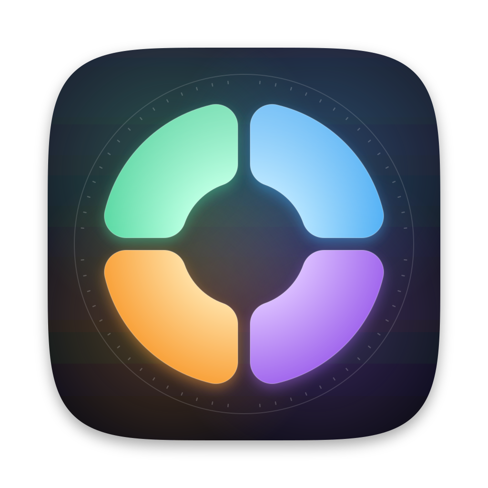

# Interface design

Dropster should feel like a utility that ships with macOS: quiet, fast, and honest about
what it did.

## Brand



The mark is the clover dial reduced to its essence: **four rounded petals around an open
centre**, separated by a cross-shaped gap, inside the dial's watch bezel.

- **Petals** keep their positions and colours from the dial: mint upper-left, sky upper-right,
  violet lower-right, amber lower-left. Each runs from a pale glow at the core to full colour at
  the rim, with a white sheen across the top and a soft glow in its own colour.
- **Body**: a macOS superellipse in midnight ink (#1F2536 → #0D0F17) with a faint aurora of
  the four petal colours and the dial's watch bezel: a hairline ring and 64 ticks.
- **Menu bar**: a monochrome template of the four petals, which macOS tints for light and dark
  menu bars.

Everything is generated from one geometry by `swift scripts/make-icon.swift`:

- `Packaging/AppIcon.icon`: an Icon Composer document (gradient fill plus three full-bleed layers:
  backdrop, and petals in glass). `scripts/build-app.sh` compiles it with `actool` into
  `Assets.car`, so macOS 26+ masks, lights and renders it in Liquid Glass. A plain `.icns` that
  draws its own rounded shape is shown shrunk on a grey platter on those systems.
- `Packaging/AppIcon.icns`: the pre-rendered icon, used where `actool` isn't available.
- `Packaging/MenuBarIcon*.png`: the menu bar template.
- `assets/brand/`: `dropster-icon.svg`, `dropster-mark.svg` (transparent), `dropster-menubar.svg`,
  `dropster-icon-1024.png`.

## Principles

1. **One window, one job.** Drop files, see results. No dashboard, no cards.
2. **Results are measured.** Sizes are real file sizes; quality is SSIM measured on this Mac.
   When a result is not smaller, the row says "Already optimal" and nothing is written.
3. **Only real controls.** Menus list only operations an available engine can perform.
4. **System first.** System fonts, materials, accent colour, light and dark appearance,
   standard toolbar, inspector, Settings and menus.

## Layout

```
┌──────────────────────────────────────────────────────────────┬────────────────┐
│ (+) Dropster        [ Smallest | Balanced | Fastest ]  ‖ ✓ ▣ │                │
├──────────────────────────────────────────────────────────────┤   Inspector    │
│ ▢ Coastline.jpg                 Optimize ⌄  694 KB → 405 KB −42% │  preview      │
│   JPEG · 2400 × 1266 · 694 KB                                │  result        │
│ ▢ Tone.wav                       → FLAC ⌄   441 KB → 69 KB  −84% │  suggestions  │
│   WAV · 0:05 · 441 KB                                        │  details       │
├──────────────────────────────────────────────────────────────┤                │
│ 6 of 6 done   Saved 4.1 MB (59%)              🔒 Local only  │                │
└──────────────────────────────────────────────────────────────┴────────────────┘
```

- **Toolbar**: Add (⌘O) at the leading edge; the compression mode as a segmented control in
  the centre (it applies to every file, so it belongs in the window chrome); Pause, Clear
  Finished and the inspector toggle on the trailing edge. A Start button appears only when
  "Start as soon as files are added" is off.
- **Rows**: 38 pt thumbnail with a 7 pt continuous corner; name (medium weight, middle
  truncation) over a secondary subtitle of format · dimensions/duration · size; an
  operation menu (`Optimize`, `→ WebP`, `Remove Metadata`); a fixed 190 pt status column so
  results line up.
- **Status column states**: spinner (analyzing), "Waiting", linear progress + % + cancel,
  `before → after` with a savings capsule (green for smaller, orange for larger),
  "Already optimal" with a tooltip giving both sizes, or a warning glyph with the error.
- **Status bar**: done count, total saved with percentage, time remaining once there is
  measured throughput, and a permanent "Local only" marker.
- **Inspector** (`.inspector`, 260–420 pt): preview, result (size, savings, size bars,
  method or route, time, measured quality, Compare and Show in Finder), suggestions with
  one-click actions, then file details.
- **Compare sheet**: before/after with a draggable divider, Fit or Actual Size (1:1 pixels,
  no interpolation, so artefacts are visible), sizes on each side, SSIM verdict.

## The clover dial

Dropster's signature: a round dial that opens under the cursor, a four-leaf clover drawn as a circle.

```
              ·  ·  ·  ·  ·  ·              bezel: 64 ticks, long ticks where the gaps meet it
          ╭─────────╮ ╭─────────╮     ( WEBP )   beads ride an orbit beyond the bezel,
          │ OPTIMIZE│ │   WEB   │ ═══( AVIF )    linked by an arc in the petal's colour
          │  mint   ╰─╯   sky   │     ( PNG )
          ╰─────  ( 2 )  ───────╯                core: file count; rest = turn over
          ╭─────  FILES  ───────╮
          │ PRESETS ╭─╮ FORMATS │
          │  amber  │ │ violet  │
          ╰─────────╯ ╰─────────╯
        [ Convert to WebP · 2 files ]            caption: exactly what a drop will do
```

- **Petals**: four quadrants of an annulus (inner radius 37 pt, outer 104 pt) centred on the
  diagonals, with 13 pt rounded corners and a constant 5 pt cross-shaped gap. Built as the exact
  inset quadrant grown back by a round-joined stroke, so every corner rounds evenly.
- **Colour by position**, identical on both faces so place and colour always mean the same
  thing: mint upper-left, sky upper-right, violet lower-right, amber lower-left. At rest a petal
  is a diagonal wash of its hue (30% → 55% toward the rim); under the pointer it becomes a
  radial gradient from a pale glow to the full hue, lifts 5 pt outward, grows 2.5% and casts a
  coloured glow. Other petals dim to 35% while one is open; unavailable petals are a 5% neutral.
- **Body**: a glass coin (`.regularMaterial`, 116 pt radius) with a soft 18 pt shadow.
- **Bezel**: hairline ring with 64 ticks; the four long ticks sit where the gaps meet the rim.
- **Rest feedback**: resting on a petal fills its stretch of the bezel with a 3.5 pt arc in its
  colour over 300 ms; when the arc closes the beads fan out. Resting on the core winds a ring
  around it over 700 ms; when it closes the dial turns over.
- **Beads**: 46 pt circles on a 150 pt orbit, glass with a 1.5 pt ring in the petal's colour,
  heavy rounded labels; they spring out of their petal (response 0.32, damping 0.66) 22 ms
  apart. The hovered bead fills with the petal's gradient, grows 16% and glows. A dotted orbit
  and an arc in the petal's colour join the beads.
- **Core**: 32 pt radius, thick material; file count in rounded bold (or a wand and TOOLS on the
  back); shows the turn-over arrow while hovered.
- **Opening**: an iris twist: scale 0.62 → 1, rotate −28° → 0, blur 6 → 0, together.
- **Turning over**: two quarter turns around the vertical axis with the face swapped at the edge.

### Haptics (Force Touch trackpads)

| Moment | Feedback |
|---|---|
| Dial appears, beads fan out | `generic` |
| Pointer crosses into a petal, bead or the core | `alignment` detent, throttled to one per 45 ms so a sweep feels like a rotary click |
| Dial turns over | `levelChange` |
| Drop or click that starts work | `levelChange` then `alignment` 90 ms later |
| Batch finishes (cursor ring) | `levelChange` |

### Faces

| Files | Front petals | Back petals |
|---|---|---|
| Images | Optimize · Web · Formats · Presets | Crop · Rotate · Colour · Combine |
| Video | Optimize · Video · Audio · Presets | Frames · Clean · Compress · Combine |
| Audio | Optimize · Compact · Lossless · Presets | Clean · Compress · Combine |
| PDF | Compress · Pictures · Pages · Presets | Combine · Clean · Compress |
| Documents | PDF · Word · Web & Text · Presets | Combine · Compress |
| Mixed | Optimize · Compress · Combine · Clean | Combine · Compress |

A file's own format is never offered as a conversion.

The panel is borderless, transparent and non-activating, so the app being dragged from stays
in front. After a drop the clover collapses and a 70 pt **progress ring** takes its place:
download speed and size for web pictures, then percentage, then a checkmark with the space
saved. Clicking it opens the main window on those files.

## Crop Studio

The picture fills the window on the under-page background. Outside the frame is frosted
(`.ultraThinMaterial` + 25% black); the frame is a 1.5 pt accent line with eight white handles.
A rule-of-thirds grid appears only while dragging, a size chip follows the frame, and the
frame's centre snaps to the picture's centre lines within 8 pt (shown as dashed accent guides).
**A** opens the aspect dial where the pointer is: seven ratios on a ring (Free, Original, 1:1,
5:4, 4:3, 3:2, 16:9, also keys 1–7) around a button that swaps portrait and landscape (**X**).
The bottom bar has the thumbnail strip with per-file state, Skip, Crop All Remaining, and
Crop & Next (↩), which reads Crop & Save on the last picture.

## Empty state

A 112 pt soft circle with `arrow.down.doc`, "Drop files or folders", a one-line description
including the current mode, a large "Choose Files…" button, and "Processed on this Mac.
Nothing is uploaded." A dashed outline frames the window. While dragging, the circle and
outline switch to the accent colour, the symbol becomes `arrow.down.circle.fill` and the
circle grows 6% with a spring (response 0.3, damping 0.7). With files present, a drag
draws an accent outline around the list instead.

## Colour and type

- System colours only: `accentColor` for interaction and progress, semantic `.primary`,
  `.secondary`, `.tertiary` for text, `.green` / `.orange` only for size outcomes.
- Savings capsule: semibold callout, monospaced digits, colour at 12% opacity behind.
- Monospaced digits wherever numbers update (sizes, progress, ETA).

## Feedback

- Haptic `alignment` on drop, `levelChange` when a batch finishes (Force Touch trackpads).
- Dock badge shows files still in progress; the Dock icon bounces once if the batch finishes
  while Dropster is in the background.
- Animations are short (150 ms fades) and only where state changes.

## Keyboard

| Shortcut | Action |
|---|---|
| ⌘O | Add files |
| ⌘↩ | Start |
| ⌥⌘P | Pause / resume |
| ⌘. | Cancel all |
| ⌘K | Clear finished |
| ⌘⌫ / Delete | Remove selected |
| ⇧⌘Y | History |
| ⌘, | Settings |
| ⌥⌘D | Clover for the Finder selection or clipboard (global) |
| Tab / scroll | Turn the clover over |
| Esc | Close the clover or the aspect dial |
| A / X / 1–7 | Crop Studio: aspect dial, swap orientation, choose ratio |

## Accessibility

Rows combine into one accessibility element; the savings capsule reads as "42% smaller";
cancel buttons and decorative thumbnails are labelled or hidden. All controls are standard
SwiftUI controls, so they work with VoiceOver, Full Keyboard Access and Increase Contrast.
